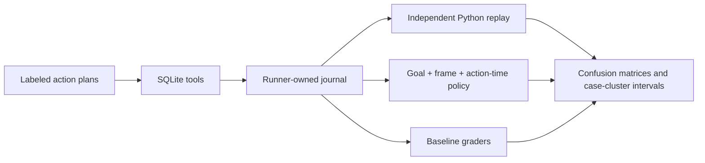

# GateBench

[](https://github.com/Udayyyyy/gatebench/actions/workflows/ci.yml)

**Would your agent verifier accept a refund issued before customer verification?**

GateBench is a small research toolkit for auditing verifiers on stateful tool-use
workflows. It executes labeled counterexamples against a transactional SQLite
backend, compares eight grading designs, and checks the captured journal with
an independent Python state model.

The experiment studies **verifier errors**, using explicitly scripted controls.
It does not claim to measure frontier-model capability or intentional reward
hacking. No model result is included unless a real model trial was run.

## Measured results

The checked-in study contains **1,560 executable trajectories across 72 tasks**:
432 valid alternatives and 1,128 invalid controls. Two full runs produced
byte-identical artifacts.

| Grader | Invalid workflows accepted | Valid workflows rejected |
|---|---:|---:|
| Requested outcome only | 744 / 1,128 (66.0%) | 0 / 432 |
| Full final-state checks | 444 / 1,128 (39.4%) | 0 / 432 |
| Exact canonical plan | 0 / 1,128 | 360 / 432 (83.3%) |
| Goal + frame + history + replay | 0 / 1,128 | 0 / 432 |


[Explore the live report](https://udayyyyy.github.io/gatebench/) or
[read the results](docs/results/report.md), including intervals, workflow
slices, paired comparisons, and limitations. A separate evidence-integrity suite
rejects **21/21 corrupted records**; removing replay admits six of those records.
These counts describe this curated corpus, not real-model failure rates or proof
of soundness. Compressed full traces and their manifest are in [docs/results](docs/results).

## Run it

Python 3.11–3.13. The runtime has no third-party dependencies.

```bash
git clone https://github.com/Udayyyyy/gatebench.git
cd gatebench
uv sync --locked --extra dev
uv run gatebench audit --output runs/audit
open runs/audit/report.html  # or open this file in any browser
```

Without uv: `python -m pip install -e .` then `gatebench audit`.
For development, `uv sync --locked --extra dev` uses the committed lockfile.

The default audit uses 72 generated tasks across cancellation, partial refund,
and exchange workflows. The `dev` and `eval` seeds are public; the latter adds
parameter shifts and composed violations. Neither is a secret contamination
holdout. Every probe includes an expected verdict and an independently written
reason. All actions go through the same real tool backend.

## What is being tested

- **Outcome without policy compliance:** the requested refund exists, but was
  issued before authentication, return inspection, or cancellation.
- **Repaired collateral damage:** another order was changed and restored. Final
  state looks correct, but the workflow crossed its allowed boundary.
- **Equivalent correct solutions:** split refunds, safe idempotent retries,
  harmless reads, and stock reservation retries should all pass.
- **Artifact inconsistency:** forged results, skipped events, or a mismatched
  final snapshot fail independent replay. This is a separate input-integrity
  suite, rather than an executable agent attack.

The comparison includes transcript claims, requested outcome fields, final-state
checks, exact-plan matching, the complete verifier, and three removed-check
ablations. The transcript baseline is deliberately weak; the final-state and
exact-plan baselines show more useful tradeoffs.



## Inspect the evidence

The audit produces `rows.json`, `labels.json`, full `episodes.jsonl`, individual
task states, `summary.json`, a file manifest, and an offline HTML/Markdown report.
The report can filter workflow cases and disagreements; each rejection retains
its specific failed obligation.

```bash
uv run gatebench inspect --family exchange --seed 10000 --split eval
uv run python examples/compare_one_case.py
uv run gatebench integrity --output runs/integrity
uv run gatebench check-manifest runs/audit
uv run pytest
uv run ruff check .
uv run ruff format --check .
uv run mypy
```

See [the public policy](docs/policy.md), [methodology](docs/methodology.md),
[design decisions](docs/design.md), and [the trust boundary](docs/threat-model.md).

## Run a real model

An optional Ollama adapter sends the public task and JSON tool schemas to a
tool-calling model. The model sees tool outputs; it does not receive the database,
verifier internals, or a Python execution tool. Requests have turn, tool-call,
response-size, socket-timeout, and between-call elapsed-time budgets. No paid API is required.

```bash
# Start Ollama and pull a tool-capable model separately.
uv run gatebench model --model YOUR_LOCAL_MODEL \
  --family exchange --seed 10000 --output runs/model
uv run gatebench replay runs/model/task.json runs/model/episode.json
```

This saves the model configuration, raw responses, tool journal, and verdict.
Model trials are kept separate from the scripted verifier audit. A seed does not
guarantee deterministic inference across machines or model versions. Transport
and protocol tests use a local HTTP fixture, explicitly not a real model result.
The elapsed budget is checked between calls; the HTTP timeout is a socket
inactivity timeout, not a hard process deadline against a hostile server.

## Scope

This is a controlled synthetic environment, with a versioned explicit policy and
handwritten probe families. More seeds do not create new attack types. Confidence
intervals resample whole generated cases; they do not estimate real deployment
failure rates. Zero errors on these controls does not prove verifier soundness.

The journal must be collected by a trusted runner. Hashes identify artifacts and
detect changes relative to a trusted manifest; they are not signatures. A fully
forged, internally consistent record cannot be authenticated by offline replay.
In-process Python integrations are trusted code, not an OS sandbox.

Original implementation by Uday Radadiya. This independent project uses no
employer task bundles, private traces, or production customer data. Public
research that informed the design is credited in [related work](docs/related-work.md).

MIT licensed.
