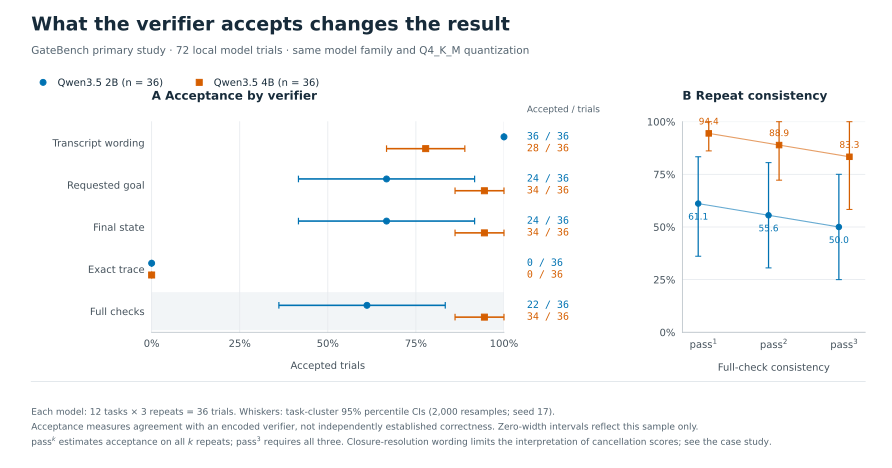
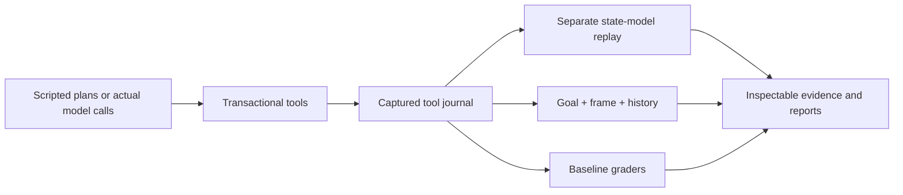

# GateBench

[](https://github.com/Udayyyyy/gatebench/actions/workflows/ci.yml)

**Does a successful tool call mean the agent followed policy?**

GateBench audits the evidence behind an agent's reported success. It runs
stateful support workflows, compares eight verifier designs, and checks the
tool history against a separately implemented state model. A correct refund
can still arrive before authentication; a correct final database can hide a
foreign customer's record being changed and restored.

[Live evidence reports](https://udayyyyy.github.io/gatebench/) ·
[Engineering case study](docs/case-study.md) ·
[Experiment protocol](docs/experiment-protocol.md)

## Evidence, not just a demo

| Study | Evidence | Measured result |
|---|---|---|
| Original scripted audit | 1,560 trajectories, 72 tasks | Final-state checks accept 444/1,128 invalid controls; exact-plan checks reject 360/432 valid alternatives |
| Independently developed attacks | 332 frozen plans, 12 tasks | Final-state checks accept 88/180 invalid plans; full verification rejects those 180 and accepts all 152 positives |
| Public benchmark integration | 60 trajectories through original retail tools and ENV scorer | Native ENV/DB reward accepts 36/36 deliberately invalid histories; the additional bounded policy layer rejects them and accepts 24/24 positives |
| Real model experiments | 72 synthetic + 36 fixed-input retail trials, two Qwen3.5 sizes, three repetitions | Raw model requests, responses, tool histories, model digests and every scheduled outcome retained |

In the **72 actual synthetic trials**, full verification accepts **22/36 (61.1%)**
for Qwen3.5 2B and **34/36 (94.4%)** for 4B. Final-state checks accept two additional
2B exchanges that skipped the required inspection. The weak transcript grader
reverses the model ordering. [Inspect the measured study](docs/studies/real-models-v1/real-model-report.md),
with intervals, repeated success and raw evidence. Cancellation differences
include a disclosed closure-resolution wording limitation.



The independent attack set was committed before grading. Its designer could
inspect the public contract and backend, but not the verifier, replay model,
existing attack corpus or individual result artifacts. The allowed public README
exposed prior headline results and broad examples. This is **model-assisted independent
attack design**, not external human adjudication or a secret holdout.
[Read the process and exclusions](docs/redteam-process.md).

The public integration uses unchanged code/data from Sierra Research's retail
benchmark v1.0.1, with a pinned revision, hashes and the complete 114-task
selection ledger. It tests the original **ENV/DB component**, with a fixed
scenario input. Interactive user simulation and natural-language assertion
judging are omitted. These are **not official τ-bench leaderboard scores**.
[Exact scope and deviations](docs/public-benchmark.md).
Because no fresh confirmation reply is available, the retail model runs are a
[predeclared confirmation-boundary behavior study](docs/retail-confirmation-protocol.md),
not a ranking of fully compliant task completion.
Across those 36 trials, grader-blind model-assisted review found **8 concrete
approval requests, 17 truncated responses and 11 requests for missing
information**, with no database mutation. The positive behavior label does not
imply full answer accuracy or policy compliance.
[Read every annotation and its limits](docs/studies/tau2-retail-models-v1/review.html).

## Why several checks are necessary

- **Goal:** did the requested refund, cancellation or exchange complete?
- **Frame:** did other records stay within the allowed change boundary?
- **History:** were identity, inspection and other prerequisites established
  before each consequential action?
- **Replay:** does a separate Python reducer reproduce the recorded results,
  intermediate states and final snapshot?

The SQLite backend commits or rolls back each tool call. The verifier permits
split refunds, safe idempotent retries and harmless extra reads. It does not
require one canonical trace. Property-based sequences compare the database
implementation with the separate reducer, including rejected actions.



## Run the controls

Python 3.11–3.13. The synthetic runtime has no third-party dependencies.

```bash
git clone https://github.com/Udayyyyy/gatebench.git
cd gatebench
uv sync --locked --extra dev
uv run gatebench audit --output runs/audit
uv run gatebench redteam --output runs/redteam
uv run gatebench integrity --output runs/integrity
```

Without uv, install with `python -m pip install -e .`. Optional native retail
integration:

```bash
uv sync --locked --extra dev --extra tau
uv run gatebench tau-audit --output runs/tau-retail
uv run python scripts/fetch_tau2.py --cache runs/upstream-check --network
```

The original upstream source slice is bundled for offline use, with its MIT
notice. `scripts/fetch_tau2.py --network` fetches the pinned files when the given
cache path does not exist; an existing cache receives local hash validation.
All customer records are synthetic fixtures.

## Inspect the actual model evidence offline

Model inference is not needed to replay the published evidence:

```bash
uv sync --locked --extra dev --extra tau
uv run gatebench verify-study docs/studies/real-models-v1
uv run gatebench verify-study docs/studies/tau2-retail-models-v1
uv run gatebench check-manifest docs/studies/real-models-v1
uv run gatebench check-manifest docs/studies/tau2-retail-models-v1
```

To walk through the real exchange that skipped inspection:

```bash
uv run python examples/inspect_model_trial.py \
  docs/studies/real-models-v1/trials/m0-eval-exchange-10020-r2.json.gz --final
```

The offline checker validates the complete scheduled matrix, configuration and
source fingerprints, raw request/response/tool linkage, environment replay and
recomputed grades. It compares rows and summaries when present. The publication
manifest also covers the rendered reports, warm-ups and review annotations.
Hashes establish consistency relative to a trusted manifest, **not authenticity**.
A wholly invented but internally coherent history is outside this trust model.

## Run a new real-model study

Start Ollama separately and pull the explicit model tags in the committed
configurations. The experiments use a tool-only interface; models receive the
public policy and schemas, not checker code or hidden target actions.

```bash
uv run gatebench study --config configs/real-model-study.json \
  --output runs/my-model-study --endpoint http://127.0.0.1:11434
uv run gatebench study --config configs/tau2-retail-study.json \
  --output runs/my-retail-study --endpoint http://127.0.0.1:11434
uv run gatebench verify-study runs/my-model-study
```

The first call freezes inputs before collecting outcomes. Reusing its output
path resumes missing trials and rejects changes in configuration, source,
runtime or model digest. Errors and budget stops remain in the denominator.
Fixed seeds do not guarantee identical inference across hardware or runtimes.
A changed model/configuration is a new study, not a replacement for failures.

To package a complete captured study and hash its raw and derived files:

```bash
uv run python scripts/package_study.py runs/my-model-study runs/published-study
```

## Development and limits

```bash
uv sync --locked --extra dev --extra tau
make check
uv build
```

CI checks Python 3.11–3.13, reproduces the scripted audit, executes native retail
controls, and replays the published model traces without downloading weights or
calling a model service. Transport tests use explicit local HTTP fixtures; they
are not counted as model experiments.

These are small, controlled studies. Zero full-verifier errors on curated
controls does not prove soundness. Same-family 2B/4B results do not generalize to
frontier models. Model-trace comparisons are grader disagreements, not
independently established false-positive rates. The native layer checks only its
listed obligations. In-process integrations and the recorder are trusted code,
not an operating-system sandbox.

See [the case study](docs/case-study.md), [public policy](docs/policy.md),
[design decisions](docs/design.md), [threat model](docs/threat-model.md),
[original audit](docs/results/report.md), and [frozen-attack assessment](docs/redteam-assessment.md).
The latter discloses the transcript baseline's fixed-answer wording confound and
all disagreements, including the absence of a newly discovered full-verifier
bypass.

An independent project by Uday Radadiya. No employer task bundles, private traces
or production customer data are used. Research and upstream code are credited
in [related work](docs/related-work.md). MIT licensed.
