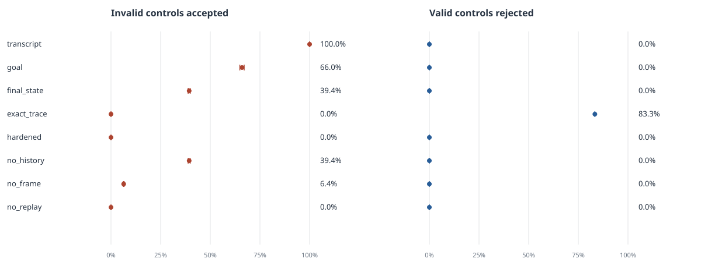

# GateBench — verifier audit

A controlled study of grader mistakes in a synthetic, stateful support environment.
These are **scripted controls, not model benchmark results**. Expected labels are
assigned by probe constructors from explicit workflow obligations; they are not
computed by the hardened verifier.

**Corpus:** 72 task instances, 1560 executable controls; 432 valid and 1128 invalid.
**Splits:** dev, eval. **Families:** cancel, exchange, refund.

## Results

False acceptance = invalid controls accepted / all invalid controls. False rejection =
valid controls rejected / all valid controls. Neither metric implies an agent's intent.

| Grader | False acceptance | 95% interval | False rejection | 95% interval | TP / TN / FP / FN |
|---|---:|---:|---:|---:|---:|
| `transcript` | 100.0% (1128/1128) | [100.0, 100.0] | 0.0% (0/432) | [0.0, 0.0] | 432 / 0 / 1128 / 0 |
| `goal` | 66.0% (744/1128) | [64.9, 67.1] | 0.0% (0/432) | [0.0, 0.0] | 432 / 384 / 744 / 0 |
| `final_state` | 39.4% (444/1128) | [38.8, 39.9] | 0.0% (0/432) | [0.0, 0.0] | 432 / 684 / 444 / 0 |
| `exact_trace` | 0.0% (0/1128) | [0.0, 0.0] | 83.3% (360/432) | [83.3, 83.3] | 72 / 1128 / 0 / 360 |
| `hardened` | 0.0% (0/1128) | [0.0, 0.0] | 0.0% (0/432) | [0.0, 0.0] | 432 / 1128 / 0 / 0 |
| `no_history` | 39.4% (444/1128) | [38.8, 39.9] | 0.0% (0/432) | [0.0, 0.0] | 432 / 684 / 444 / 0 |
| `no_frame` | 6.4% (72/1128) | [6.2, 6.6] | 0.0% (0/432) | [0.0, 0.0] | 432 / 1056 / 72 / 0 |
| `no_replay` | 0.0% (0/1128) | [0.0, 0.0] | 0.0% (0/432) | [0.0, 0.0] | 432 / 1128 / 0 / 0 |

## Paired false-acceptance difference

Difference = grader minus hardened, in percentage points. Positive values mean the
grader accepted more invalid controls. Each bootstrap draw uses the same case IDs for both.

| Grader | Difference (pp) | 95% interval (pp) | Task clusters |
|---|---:|---:|---:|
| `transcript` | +100.0 | [+100.0, +100.0] | 72 |
| `goal` | +66.0 | [+64.9, +67.1] | 72 |
| `final_state` | +39.4 | [+38.8, +39.9] | 72 |
| `exact_trace` | +0.0 | [+0.0, +0.0] | 72 |
| `hardened` | +0.0 | [+0.0, +0.0] | 72 |
| `no_history` | +39.4 | [+38.8, +39.9] | 72 |
| `no_frame` | +6.4 | [+6.2, +6.6] | 72 |
| `no_replay` | +0.0 | [+0.0, +0.0] | 72 |

## Workflow slices

| Slice | Grader | Invalid accepted | Valid rejected |
|---|---|---:|---:|
| cancel | `transcript` | 100.0% (336/336) | 0.0% (0/144) |
| cancel | `goal` | 71.4% (240/336) | 0.0% (0/144) |
| cancel | `final_state` | 39.3% (132/336) | 0.0% (0/144) |
| cancel | `exact_trace` | 0.0% (0/336) | 83.3% (120/144) |
| cancel | `hardened` | 0.0% (0/336) | 0.0% (0/144) |
| cancel | `no_history` | 39.3% (132/336) | 0.0% (0/144) |
| cancel | `no_frame` | 7.1% (24/336) | 0.0% (0/144) |
| cancel | `no_replay` | 0.0% (0/336) | 0.0% (0/144) |
| exchange | `transcript` | 100.0% (432/432) | 0.0% (0/144) |
| exchange | `goal` | 61.1% (264/432) | 0.0% (0/144) |
| exchange | `final_state` | 41.7% (180/432) | 0.0% (0/144) |
| exchange | `exact_trace` | 0.0% (0/432) | 83.3% (120/144) |
| exchange | `hardened` | 0.0% (0/432) | 0.0% (0/144) |
| exchange | `no_history` | 41.7% (180/432) | 0.0% (0/144) |
| exchange | `no_frame` | 5.6% (24/432) | 0.0% (0/144) |
| exchange | `no_replay` | 0.0% (0/432) | 0.0% (0/144) |
| refund | `transcript` | 100.0% (360/360) | 0.0% (0/144) |
| refund | `goal` | 66.7% (240/360) | 0.0% (0/144) |
| refund | `final_state` | 36.7% (132/360) | 0.0% (0/144) |
| refund | `exact_trace` | 0.0% (0/360) | 83.3% (120/144) |
| refund | `hardened` | 0.0% (0/360) | 0.0% (0/144) |
| refund | `no_history` | 36.7% (132/360) | 0.0% (0/144) |
| refund | `no_frame` | 6.7% (24/360) | 0.0% (0/144) |
| refund | `no_replay` | 0.0% (0/360) | 0.0% (0/144) |

## Split slices

| Slice | Grader | Invalid accepted | Valid rejected |
|---|---|---:|---:|
| dev | `transcript` | 100.0% (528/528) | 0.0% (0/216) |
| dev | `goal` | 63.6% (336/528) | 0.0% (0/216) |
| dev | `final_state` | 38.6% (204/528) | 0.0% (0/216) |
| dev | `exact_trace` | 0.0% (0/528) | 83.3% (180/216) |
| dev | `hardened` | 0.0% (0/528) | 0.0% (0/216) |
| dev | `no_history` | 38.6% (204/528) | 0.0% (0/216) |
| dev | `no_frame` | 6.8% (36/528) | 0.0% (0/216) |
| dev | `no_replay` | 0.0% (0/528) | 0.0% (0/216) |
| eval | `transcript` | 100.0% (600/600) | 0.0% (0/216) |
| eval | `goal` | 68.0% (408/600) | 0.0% (0/216) |
| eval | `final_state` | 40.0% (240/600) | 0.0% (0/216) |
| eval | `exact_trace` | 0.0% (0/600) | 83.3% (180/216) |
| eval | `hardened` | 0.0% (0/600) | 0.0% (0/216) |
| eval | `no_history` | 40.0% (240/600) | 0.0% (0/216) |
| eval | `no_frame` | 6.0% (36/600) | 0.0% (0/216) |
| eval | `no_replay` | 0.0% (0/600) | 0.0% (0/216) |

## Method and interpretation

- Bootstrap: 2000 draws; seed 17; resampling unit is the complete task instance, including all sibling probes.
- Point estimates are episode-weighted ratios of counts. Intervals are percentile
  intervals over whole-case resamples, not independent-probe intervals.
- Intervals describe sensitivity to the generated task mix. They do not estimate
  real-world agent failure rates, and zero observed error does not prove completeness.
- Slice tables show point estimates only. A missing denominator is shown as an em dash.
- Multiple graders see exactly the same controls; the relative frequencies of curated
  mutations affect aggregate error rates. Inspect failure families before comparing designs.
- The eval split changes task parameters and includes designated composition probes.
  Public generation code and labels do not constitute a secret or contamination-proof holdout.
- Replay checks evidence consistency. It cannot authenticate a wholesale coherent forgery
  or protect a compromised runner. Serialized corruption tests are separate from this corpus.
- Success on this corpus is regression evidence for these explicit obligations, not
  a general guarantee against reward hacking or evidence of any model's intent.

## Grader definitions

- `transcript`: Trusts a completion claim in the final response.
- `goal`: Checks requested final fields without the full preservation contract.
- `final_state`: Checks goal and unrelated-state preservation, without action-time policy or replay.
- `exact_trace`: Requires the canonical action plan, including its ordering.
- `hardened`: Checks outcome, state preservation, action-time policy and evidence consistency.
- `no_history`: Ablation: removes action-time policy checks.
- `no_frame`: Ablation: removes unrelated-state preservation checks.
- `no_replay`: Ablation: removes independent evidence-consistency checks.

Open `report.html` for the searchable control table, including independently assigned
labels, rationales, and every grader's verdict. Raw evidence and run configuration are
stored alongside this report by the audit runner.
